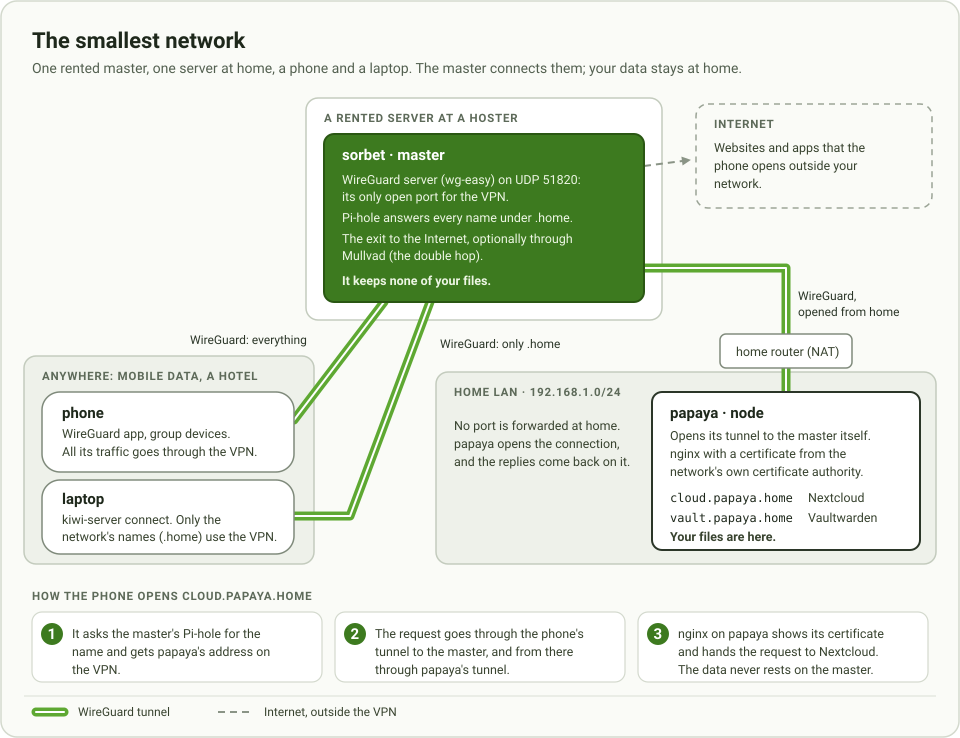
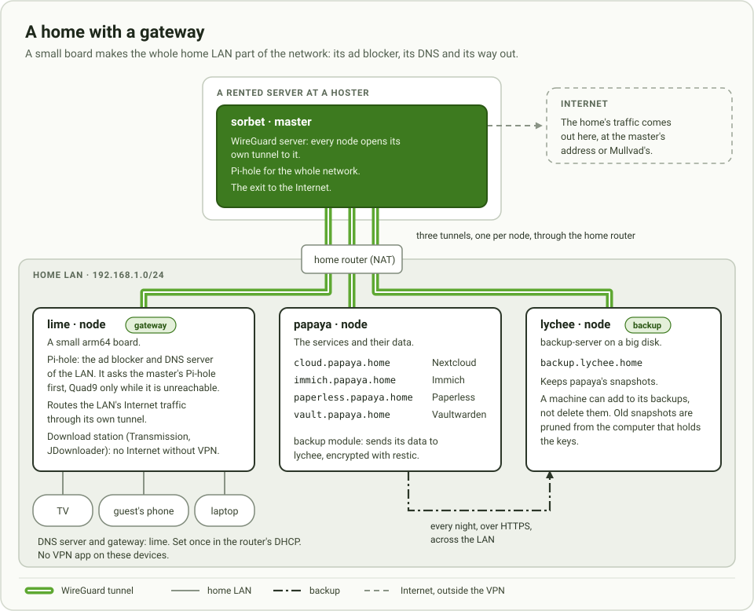
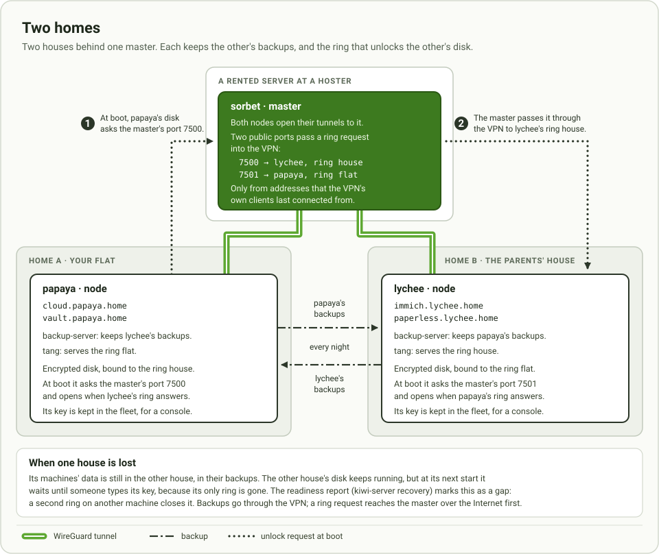
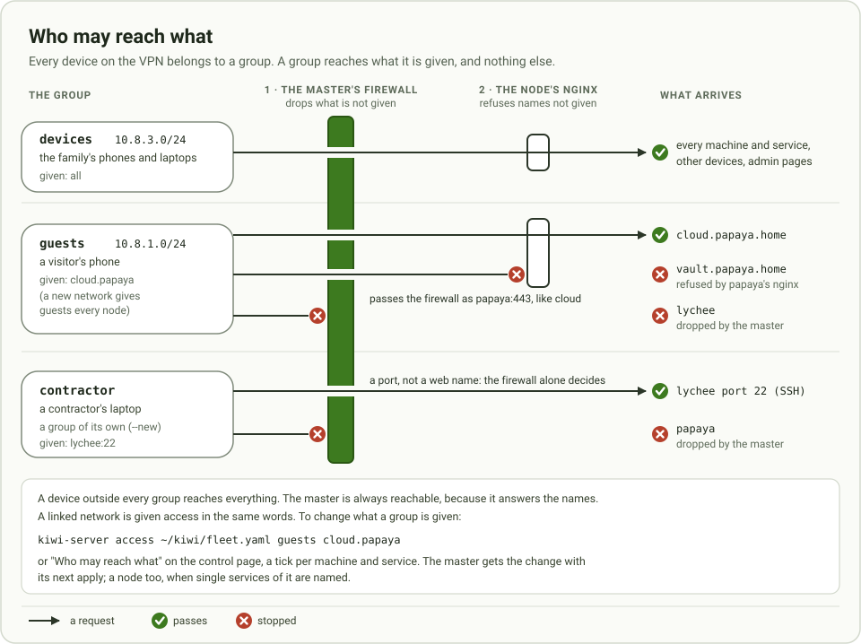
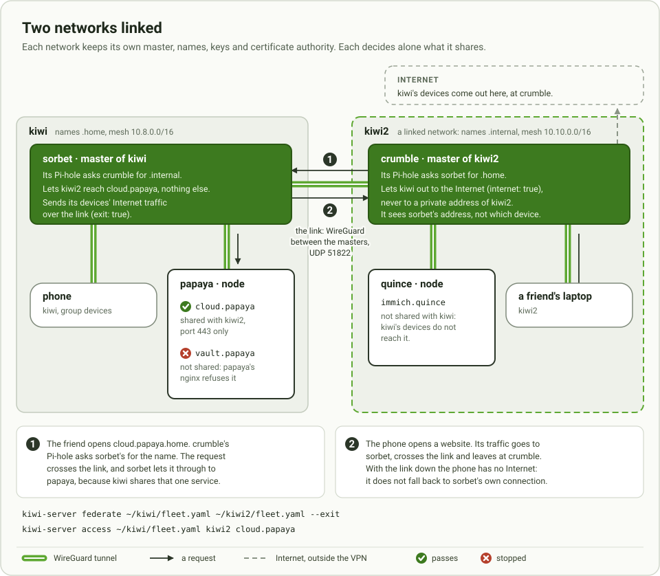
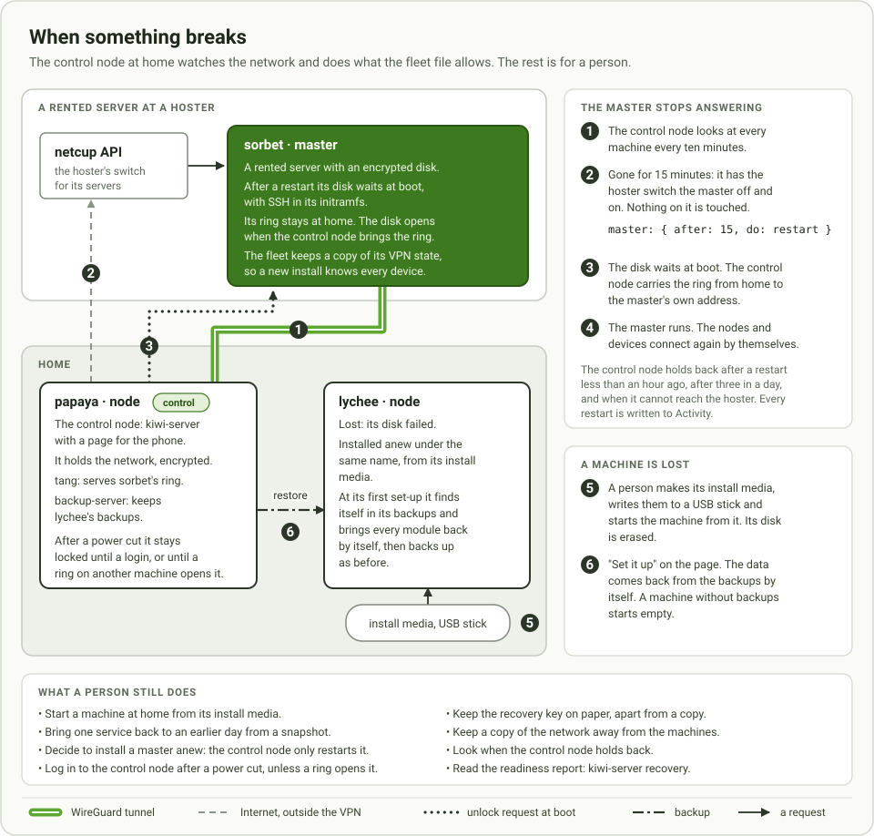

# Example setups

This page shows what a Kiwi network can look like, from the smallest one to
two networks that share services. Each picture shows one idea, with the
machines in it and what each of them does. At the end, three tables list the
parts of a network, what runs by itself, and who can reach what.

The names are examples. Masters are named after fruit dishes (`sorbet`,
`crumble`), nodes after fruits (`papaya`, `lychee`, `lime`), and the names of
the network end in `.home`.

## How to read the pictures

The same shape means the same thing in every picture.


## The smallest network

One rented server is the master: the only machine reachable from the
Internet. One server at home is a node: it runs the services and keeps your
data. Every machine and every device opens a WireGuard tunnel to the master,
so together they form one private network, a VPN. Nothing at home needs an
open port. `kiwi-server init` makes this network: it asks where the master
runs, its address, and what the machine at home does
([Getting started](getting-started.md)).



| Machine | Runs | For |
|---|---|---|
| `sorbet`, the master | the WireGuard server (wg-easy), Pi-hole for the names, optionally a VPN client to a provider such as Mullvad | connecting everything, answering every name under `.home`, the way out to the Internet |
| `papaya`, a node | a WireGuard client, nginx as the reverse proxy, Nextcloud and Vaultwarden | your files and passwords, at `cloud.papaya.home` and `vault.papaya.home` |
| a phone | the WireGuard app, in the group `devices` | everything it sends goes through the VPN |
| a laptop | the connection that `kiwi-server connect` sets up | only the network's names go through the VPN, the rest stays as it was |

The master keeps no data of yours. It holds what it needs to run: its
WireGuard keys and the list of peers, its own passwords and its certificate.
A lost master is installed anew from the fleet file. A double hop means that
the master itself leaves the Internet through a VPN provider, so websites see
the provider's address and not the master's.

## A home with a gateway

A small board in the home is the gateway: the ad blocker, the DNS server and
the way to the Internet for the whole LAN. A TV or a guest's phone is on the
network without any app, because the router's DHCP hands out the board as
their DNS server and gateway ([Using your network](using.md)). A second node
keeps the backups.



| Machine | Runs | For |
|---|---|---|
| `sorbet`, the master | as above | as above |
| `lime`, a node with the `gateway` preset | Pi-hole, routing through its VPN client, a download station (Transmission, JDownloader) | ad blocking and names for the LAN, the LAN's traffic through the VPN; the downloads have no Internet while the tunnel is down |
| `papaya`, a node | Nextcloud, Immich, Paperless, Vaultwarden, the `backup` module | the services and their data |
| `lychee`, a node | the `backup-server` module on a big disk | papaya's backups, every night, encrypted with restic |
| TV, phones, laptops at home | nothing extra | they use `lime` as DNS server and gateway |

`lime` can be an Odroid or another arm64 board ([Boards](boards.md)). Its
Pi-hole asks the master's Pi-hole first and a public resolver only while the master
cannot be reached ([The network](network.md#dns)). `papaya` can add to its
backups on `lychee` but not delete them, so a machine that is taken over
cannot destroy them ([Backups](backups.md#pruning)).

## Two homes

Two houses share one master. Each house keeps the other's backups, so a house
that burns down loses its machines but not their data. Each house also serves
the unlock ring for the other's encrypted disk. A ring is a Tang server: a
machine whose disk is bound to it opens at boot when the ring answers, with
nobody at the keyboard.



| Machine | Runs | For |
|---|---|---|
| `sorbet`, the master | the WireGuard server, and `vpn-server.unlock_relay` for ports 7500 and 7501 | connecting both houses; passing a ring request from a disk at boot into the VPN |
| `papaya`, a node in the flat | its services, `backup-server`, `tang` with the ring `flat` | its data; lychee's backups; the ring for lychee's disk |
| `lychee`, a node in the parents' house | its services, `backup-server`, `tang` with the ring `house` | its data; papaya's backups; the ring for papaya's disk |

At boot a disk has no VPN yet, so it asks the master's public address. The
master lets such a request through only from an address that one of the
VPN's own clients last connected from. The disk's own key stays in the fleet, so a ring
that is gone costs a console, not the disk
([Security](security.md#unlocking-at-boot)). A disk whose rings are all on
one other machine is a gap in the readiness report: a second ring on another
machine closes it.

## Who may reach what

Every device on the VPN belongs to a group, and a group reaches what it is
given and nothing else ([The network](network.md#who-may-reach-what)). Two
places enforce it. The master's firewall drops what is not given. A node's
nginx refuses the names of services that a group was not given, because all
services of a node share one address and port.



| Group | Given | What happens |
|---|---|---|
| `devices`, the family's phones and laptops | `all` | they reach every machine, every service, other devices and the admin pages |
| `guests`, a visitor's phone | `cloud.papaya` | the master lets port 443 of papaya through; papaya's nginx answers only `cloud.papaya.home` |
| `contractor`, a group of its own | `lychee:22` | the master lets port 22 of lychee through and drops everything else |

```bash
kiwi-server access ~/kiwi/fleet.yaml guests cloud.papaya
```

```bash
kiwi-server access ~/kiwi/fleet.yaml contractor --new lychee:22
```

On the control page this is "Access rules", with a tick per machine and
service.

## Two networks linked

Two networks can share chosen services. Each keeps its own fleet file, its
own keys, its own certificate authority (CA), its own master and its own
range of addresses. The two masters are joined by a WireGuard tunnel of
their own, the link. One network can also leave to the Internet through the
other: its devices then come out at the other network's master
([The network](network.md#federation)).



| Machine | Network | For |
|---|---|---|
| `sorbet`, a master | `kiwi`, names `.home` | lets `kiwi2` reach `cloud.papaya` and nothing else; sends its devices' Internet traffic over the link |
| `crumble`, a master | `kiwi2`, names `.internal` | lets `kiwi` out to the Internet, never to a private address of `kiwi2` |
| `papaya`, a node | `kiwi` | `cloud.papaya.home` is shared, `vault.papaya.home` is not |
| `quince`, a node | `kiwi2` | not shared: `kiwi` does not reach it |

Each master's Pi-hole asks the other for the other network's names. `crumble`
sees `sorbet`'s address, not which device of `kiwi` asks. While the link is
down, `kiwi`'s devices have no Internet: they do not fall back to `sorbet`'s
own connection.

```bash
kiwi-server federate ~/kiwi/fleet.yaml ~/kiwi2/fleet.yaml --exit
```

```bash
kiwi-server access ~/kiwi/fleet.yaml kiwi2 cloud.papaya
```

## A service for strangers

**From 2.96.0.** A hidden service, a Tor onion service, gives one service an
address that anyone opens with Tor Browser. It is for people who are not on
your VPN, strangers included. It needs no public name and no open port at
home. Tor never leaves through the connection at home: the node's Tor shares
its VPN client's network, so it goes through the tunnel and leaves at the
master.


| Machine | Runs | For |
|---|---|---|
| `papaya`, a node | the `onion` module (Tor) in its VPN client's network, and one more nginx site on port 8043 that is not published | the service `cloud.papaya` under a `.onion` address |
| `sorbet`, the master | its exit, through Mullvad or its own address | the place where papaya's Tor traffic reaches the Internet |
| a stranger | Tor Browser | opening the `.onion` address, and meeting the service's own login |

Your Internet provider at home sees WireGuard to the master and nothing else.
The address and the keys come from the network's seed, so a machine installed
anew keeps its address. With `--client`, only people who have a key can even
find the service.

```bash
kiwi-server onion ~/kiwi/fleet.yaml cloud.papaya --client anna
```

A service open to everyone is open to everyone: keep its own sign-up off
unless strangers should have accounts. Some services put their usual name
into the links they make, and such a link does not open for a stranger.

## When something breaks

The control node is a node at home that runs kiwi-server itself, with a page
for the phone ([The control node](control.md)). It looks at every machine
every ten minutes and does what the fleet file allows. A rented master that
stops answering is switched off and on at its hoster, and its encrypted disk
is opened with the ring from home. A machine that is lost is installed anew by
a person, and then brings its data back from its backups by itself.



| Machine | Runs | For |
|---|---|---|
| `papaya`, the control node | the `control` module, `tang`, `backup-server` | watching every machine, restarting the master, carrying its ring, keeping lychee's backups |
| `sorbet`, the master | an encrypted disk with SSH in its initramfs | it waits at boot until the control node brings the ring |
| `lychee`, a node | its services and the `backup` module | installed anew under the same name, it restores every module by itself |

```yaml
defaults:
  recovery:
    master: { after: 15, do: restart }   # minutes; tell or restart
```

The control node holds back after a restart less than an hour ago, after
three restarts in a day, and when it cannot reach the hoster. Every restart is
written to Activity. What a person still does: start a machine at home from
its install media, bring a service back to an earlier day, decide to install
a master anew, and keep the recovery key and a copy of the network away from
the machines. `kiwi-server recovery` says whether your network could be
brought back today ([When something breaks](recovery.md)).

## The parts

| Part | What it is | Built on | When it is gone |
|---|---|---|---|
| master | the only machine reachable from the Internet, usually a rented server; everything connects to it | the WireGuard server (wg-easy), Pi-hole, optionally a VPN client to a provider (gluetun), Tor | devices have no VPN and nothing reaches the nodes from outside; the nodes keep running and keep their data; the fleet keeps its VPN state, so a master installed anew knows every device |
| node | a machine that runs services and keeps their data, at home or in an office | a WireGuard client, nginx with a certificate from the network's own CA, one container stack per machine (`kiwi-stack`) | its services stop; installed anew, it brings its data back from its backups |
| control node | a node that runs kiwi-server, with a page for the phone | the `control` module; the network kept encrypted with age | the machines keep running, but nobody can change the network until it is back from a copy and the recovery key, or another computer takes over |
| gateway | a node that is the ad blocker, DNS server and gateway of its LAN | the `gateway` preset: Pi-hole, routing through the VPN client | devices that use it as DNS server and gateway lose names and the Internet until it is back |
| backup machine | a node with a big disk that keeps the other machines' backups | the `backup-server` module; restic over HTTPS; the `backup` module on each other machine | backups stop and `kiwi-server status` says they are late; the data on the machines is untouched |
| unlock ring | a Tang server on a node that opens other machines' encrypted disks at boot | Tang (the `tang` module), Clevis, LUKS | a disk bound only to it waits at its next start until someone types its key, which the fleet keeps |
| device | a phone, tablet or laptop on the VPN | a WireGuard configuration, as a QR code or through `kiwi-server connect` | a lost device stays on the VPN until you remove it; then its key no longer works |
| group | a range of addresses on the master, and what devices in it may reach | `vpn-server.groups`; the master's firewall; the node's nginx | a device outside every group reaches everything |
| linked network | another Kiwi network that shares chosen services with yours | federation: a WireGuard link between the masters on UDP 51822, DNS forwarded between the Pi-holes | its shared services cannot be reached; a network that leaves to the Internet through it has no Internet |
| hidden service, from 2.96.0 | one service with a `.onion` address for people outside the VPN | a Tor onion service (the `onion` module) in the VPN client's network | the address does not answer; a machine installed anew keeps the same address |

## What runs by itself

| What | How | When |
|---|---|---|
| System updates | Zincati on CoreOS, staged deployments on uCore, unattended-upgrades on Debian ([Machines](machines.md#updates)) | fetched all the time; the restart happens in the machine's update window |
| Service updates | `kiwi-stack update` by a timer | every week |
| Backups | each machine with the `backup` module sends its data to its backup machines, encrypted with restic | every night; a failed run is tried again an hour later, three more times |
| The network's own copy | the fleet file and the secret store, encrypted, as one file, sent to the machines in `backup.hosts`; each keeps the newest ten | after every render or build, when `backup.hosts` names machines |
| Unlock | a disk asks its rings at boot and opens when one answers; for a rented master the control node carries the ring | at every start |
| Restart of a master | the control node switches it off and on at its hoster, when `recovery` allows it | after the minutes the fleet file sets; never twice in an hour, at most three times a day |
| A master in RAM | `kiwi-server watch` sends its role and its VPN identity again | after every boot, while a control node or a timer on your computer watches |
| A machine installed anew | it finds itself in its backups at its first set-up and restores every module | once, before it backs up again |
| A gateway's routing | checked and put back | twice a minute |

## Who can reach what

| Who | Reaches | Enforced by |
|---|---|---|
| a device outside every group | everything on the VPN | nothing stops it |
| `devices` | everything, other devices, the admin pages | the master's firewall |
| `family` (from 2.98.0) | every app: the web pages of every node; no SSH, no admin pages | the master's firewall, and each node's nginx for the admin pages |
| `routers` | everything and other devices, no admin pages | the master's firewall, and each node's nginx for the admin pages |
| `guests`, as a new network has it | every node; no other devices, no admin pages | the master's firewall, and each node's nginx for the admin pages |
| `guests` given one service | that service's web address only | the master's firewall, and the node's nginx for its other names |
| `pentest` | nothing but the master, which answers the names | the master's firewall |
| a group given one port, such as `lychee:22` | that port | the master's firewall |
| a linked network | only what you share: a machine, a service or a port, never `all`; `from` limits which of its addresses may come | your master's firewall and the node's nginx |
| a stranger over Tor, from 2.96.0 | one service through its `.onion` address; with `--client`, only people with a key | Tor's client authorization, and the node's nginx answering as that one site |
| anyone on the Internet | the master's open ports: WireGuard on UDP 51820 and SSH, plus what you add, such as a public hub on 80 and 443, ring relay ports or a link on UDP 51822; nothing at home | the master's firewall; fail2ban for SSH and the public sites |

Admin pages are the network's controls: the control page, Portainer, Pi-hole,
the VPN's device page, the backup server, the cache. A group opens them only
with its admin switch, or when one is named for it; a linked network only when
one is named (from 2.98.0).
